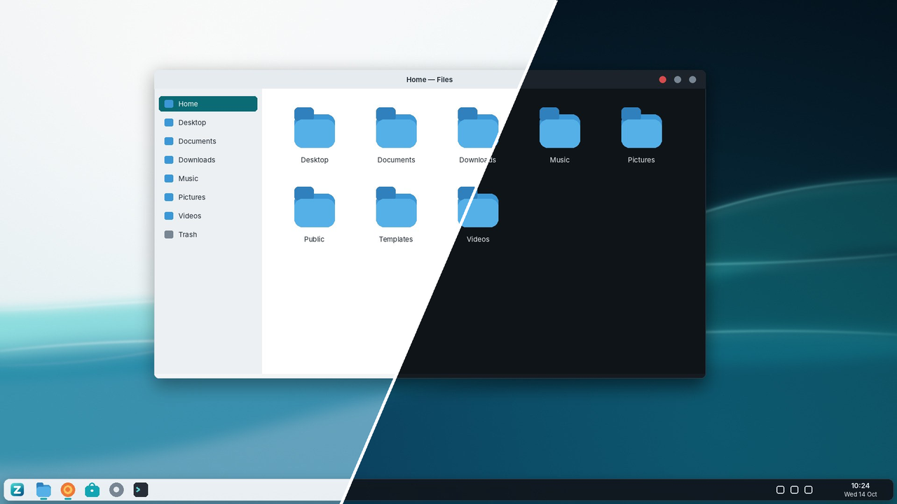

# Zovelis OS

Zovelis OS is a lightweight, secure desktop operating system for people who
are used to Windows. It is a [Debian 13 (trixie)](https://www.debian.org/)
derivative with the KDE Plasma 6 desktop, a Zovelis look, a guided
installer and a first-run Welcome app.

Zovelis OS does not fork anything. It is Debian plus six small Zovelis
packages and an image recipe, so security fixes and hardware support come
straight from Debian, and the whole system stays easy to maintain.



## What you get

| Brief requirement | How Zovelis OS provides it |
| --- | --- |
| Boots and installs on 64-bit Intel/AMD PCs | Hybrid ISO for USB sticks and DVDs, BIOS and UEFI (with Secure Boot through Debian's signed shim and GRUB) |
| Graphical desktop | KDE Plasma 6 (Wayland, with an X11 session as a fallback) |
| Wi-Fi, Bluetooth, audio, displays, input, external storage | NetworkManager, BlueZ, PipeWire, KScreen, libinput and udisks2 from Debian, plus common firmware and CPU microcode |
| Install, launch, update and remove apps | Discover (the Software Center) for Debian packages and Flatpak apps from Flathub, preconfigured |
| Web browser, file manager, terminal, settings | Firefox ESR, Dolphin, Konsole, System Settings (plus text editor, image, PDF and media viewers, calculator, screenshots) |
| Accounts, authentication, firewall, sandboxing, security updates | Local accounts with sudo-based administration and a locked root account, ufw firewall on by default, AppArmor and Flatpak sandboxing, automatic Debian security updates |
| Light and dark modes | "Zovelis Light" and "Zovelis Dark" global themes; the Welcome app switches between them |
| Few background processes | No SSH, mail or RPC server, no legacy printer browsing, no KDE PIM database or phone-pairing daemon; the mobile-broadband service stays off until needed; file search indexes names only; compressed swap in RAM and a small system log |
| Graphical installer and initial setup | Calamares installer with Zovelis branding, then the Zovelis Welcome app on first login |
| Bootable ISO for virtual machines | `build/out/zovelis-os-1.0-amd64.iso`; includes guest tools for QEMU/KVM, VirtualBox (VMSVGA) and VMware |

Not in scope for this first version, as agreed: a new kernel, own drivers, a
new compositor, or running Windows programs.

## The desktop

* **One taskbar along the bottom**: the Zovelis menu (bottom-left, or the
  Windows/Meta key), pinned apps, open windows, notification area, clock with
  date, and a "show desktop" corner.
* **Familiar shortcuts**: Meta opens the menu, Meta+E opens Files,
  Ctrl+Esc opens the System Monitor, Meta+L locks the screen.
* **Readable and accessible**: Noto Sans at a comfortable size, colour
  schemes checked against WCAG contrast rules, the Orca screen reader
  (Meta+Alt+S) and screen zoom (Meta+Plus/Minus) included, three text-size
  presets in the Welcome app.

## Repository layout

```
packages/                      Debian source packages (native, debhelper 13)
  zovelis-base/                os-release, hardening, update policy, Flathub, zram
  zovelis-artwork/             logo, icons, wallpapers, boot splash, GRUB theme
  zovelis-desktop-settings/    Plasma global themes, layout, splash, login screen, defaults
  zovelis-welcome/             Welcome / first-run app (C++ and Qt Quick)
  zovelis-desktop/             metapackage: the complete desktop
  calamares-settings-zovelis/  installer configuration, branding and helpers
live-build/                    image recipe (live-build): package lists, hooks, boot menus
branding/                      artwork generator (all artwork is made from code)
scripts/                       build scripts
tests/                         static checks, unit tests, VM tests
docs/                          architecture, building, testing, security, design
```

## Building

On Debian 13, or anywhere with Docker/Podman:

```sh
./scripts/build-in-container.sh          # packages + ISO, in a Debian 13 container
# or, on a Debian 13 machine:
sudo ./scripts/setup-build-env.sh
./scripts/build-packages.sh
sudo ./scripts/build-iso.sh
```

The ISO is written to `build/out/`. A build needs about 25 GB of free disk
space and internet access to `deb.debian.org`, `security.debian.org` and
`dl.flathub.org`. See [docs/BUILDING.md](docs/BUILDING.md).

## Testing

```sh
./tests/run-static-checks.sh                            # no ISO needed
./tests/vm/run-vm-tests.sh build/out/zovelis-os-1.0-amd64.iso bios uefi
```

See [docs/TESTING.md](docs/TESTING.md) for the manual installation checklist
and the hardware checklist.

## Documentation

* [Architecture](docs/ARCHITECTURE.md): how the pieces fit together
* [Building](docs/BUILDING.md) and [maintaining](docs/MAINTENANCE.md) Zovelis OS
* [Testing](docs/TESTING.md)
* [Security](docs/SECURITY.md): defaults, threat model, review results
* [Design](docs/DESIGN.md): brand, colours, typography, accessibility

## Licence

Code: GPL-3.0-or-later. Artwork: CC-BY-SA-4.0. The wordmark uses glyph
outlines from the Inter typeface (SIL Open Font License 1.1). Debian and KDE
software keep their own licences.
