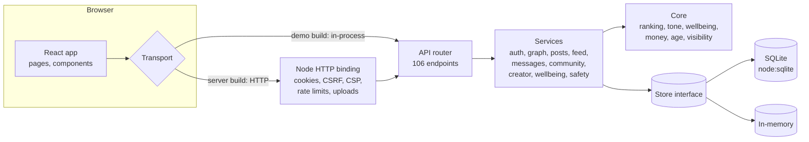

# Zemvii architecture

## The shape of it



One router and one set of services serve both builds. The web app talks to a
`Transport`: over HTTP to the Node server, or, in the demo build, straight to
the router running in the browser on the in-memory store. The demo therefore
exercises the real validation, ranking, tone check and permission rules.

## Layers

| Layer | Folder | Rules |
| --- | --- | --- |
| Data model | `server/src/store/types.ts`, `schema.ts` | Row types are the single source of truth; the schema type forces every column to be declared, so SQL and TypeScript cannot drift. |
| Storage | `server/src/store/` | `Store` is async CRUD plus a small query language (`eq`, `ne`, `in`, `nin`, comparisons, `contains`, `$or`). Transactions get their own `tx` handle; outside calls wait for them. SQLite and in-memory adapters pass the same contract tests. |
| Core | `server/src/core/` | Pure functions, no I/O: feed ranking and explanations, tone check, wellbeing time maths, money, age rules, visibility. Shared with the browser (the composer's live tone hint uses the same classifier the server enforces). |
| Services | `server/src/services/` | Business rules per area. Every read goes through `canViewPost` / `canSeePlan` with a per-request `ViewerContext`. |
| API | `server/src/api/` | Framework-agnostic `Router`: `(ApiRequest) → ApiResponse`. Access levels: public, user, admin. Errors carry a status, a stable code and a human message. |
| HTTP | `server/src/node/http.ts` | The only Node-specific layer. |
| Web | `web/src/` | React 19, no state library: a hash router, a stale-while-revalidate `useApi` hook, a session context. Design tokens in `styles/tokens.css` (light and dark). |

## Feed ranking

The Mix feed scores each candidate post (followed people, joined spaces, and,
unless the dial is at zero, public posts from others in the last 7 days):

```
d = Friends↔Discover/100, p = Fresh↔Popular/100, c = Calm/100
rel        = 1.0 circle · 0.9 friend · 0.75 follow · 0.7 you · 0.6 space · 0 stranger
fresh      = 0.5 ^ (age_hours / (6 + 42p))
appreciation = log1p(reactions + 2·comments + 3·saves) / log1p(150)
people     = rel · (1 − 0.65d)
discovery  = rel > 0 ? 0.25·interest : (0.2 + 0.8·interest)·(0.1 + 0.9d)
base       = 0.5·people + 0.3·discovery + 0.35·((1−p)·fresh + 0.35p·fresh) + 0.35·0.65p·appreciation
score      = base × (1.3 if a boosted topic) × (1 − 0.85·c·heat)
```

Excluded entirely: AI-generated posts when the AI switch is off, muted topics
and words, muted or blocked people, strangers when Friends↔Discover is 0, and
teenagers' posts for adults who don't follow them. Authors are spread out so
no one fills the screen, the list stops at 60, and contextual sponsored posts
may take at most one slot in twelve when the surrounding posts share a topic.

The same `scoreCandidate` function returns the plain-language reasons and the
breakdown shown in "Why am I seeing this?", so the explanation is always what
actually happened. Interests come from topics chosen at onboarding plus topics
of posts the person reacted to or saved in the last 30 days.

## Security and safety

- **Passwords**: PBKDF2-HMAC-SHA256, 600,000 iterations, per-user salt; length
  rules (NIST 800-63B) and a small blocklist; unknown accounts still pay the
  hash cost so login timing doesn't reveal which accounts exist.
- **Sessions**: 32 random bytes; only the SHA-256 is stored; 30-day sliding
  expiry; HttpOnly, SameSite=Lax, Secure behind HTTPS. Changing or recovering
  a password signs out other devices.
- **CSRF**: state-changing requests need `X-Zemvii: 1` (a cross-site form
  can't send it) and a matching `Origin` when one is present; JSON only.
- **Headers**: strict CSP (`script-src 'self'`, no framing), `nosniff`,
  `Referrer-Policy`, `Permissions-Policy`, COOP.
- **Rate limits** per IP: 10/min for login, sign-up and recovery; 120/min for
  writes; 600/min for reads.
- **Uploads**: type detected from magic bytes (not the client's claim), size
  caps, random file names, served with `Content-Disposition: inline` and
  `nosniff`; the web app re-encodes photos, which strips location metadata.
- **Input**: every value passes a validator (`services/validate.ts`); SQL is
  parameterised and identifiers come only from the schema; profile links must
  be http(s).
- **Authorization**: one visibility function per kind of object; blocks cut
  follows, circles, messages, visibility and notifications in both directions.
- **Teens**: protections are enforced on the server in settings, follows,
  messages, search, suggestions, recommendations, plans and payments, not
  just as interface defaults.
- **Moderation**: actions require a written explanation, are visible to the
  person, are appealable once, and an appeal can't be decided by the
  moderator who acted.

## Scaling path

| Today | Next |
| --- | --- |
| SQLite in one process | A Postgres adapter behind the same `Store` interface (it is already async); read replicas |
| Files on local disk | Object storage (S3-compatible) with a CDN; video transcoding to HLS in a worker |
| Ranking computed per request, cached per person for 30 minutes | Candidate generation from a fan-out-on-write inbox table; a shared cache (Redis) |
| `contains` search | A search engine (OpenSearch/Meilisearch) fed from a change stream |
| Polling for messages | WebSockets or SSE; end-to-end encryption with MLS |
| Notifications computed on read | A queue with push delivery (APNs/FCM/Web Push) that respects digests and quiet hours |
| Web app | React Native apps sharing the API client and core logic |
